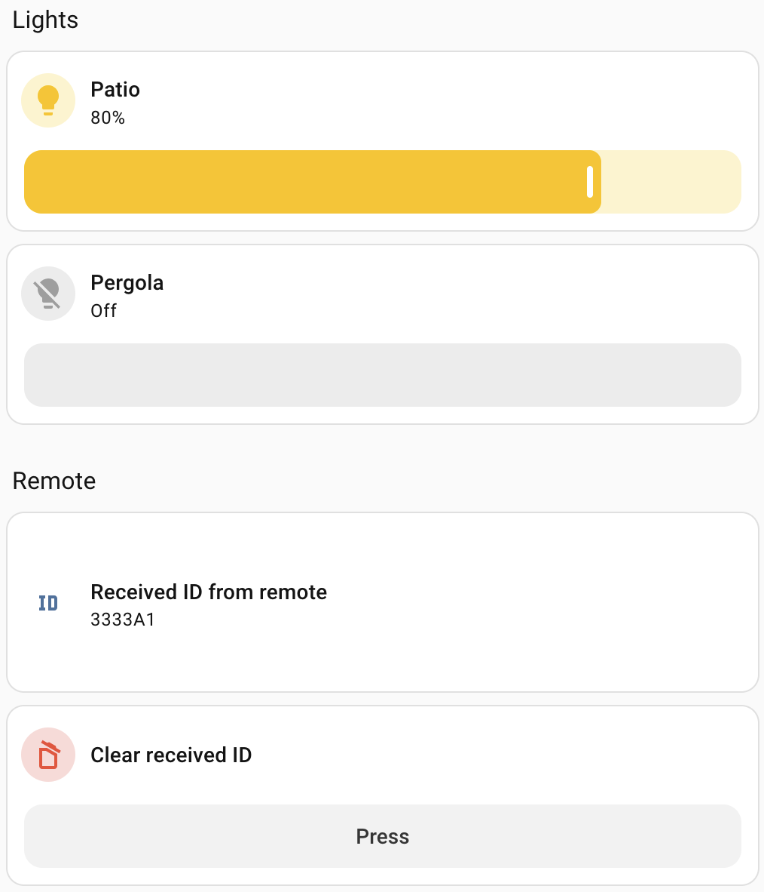
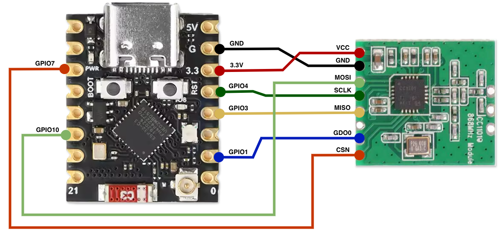

# ESPHome Sunricher Easy RF Dimmer
An [ESPHome](https://esphome.io/) configuration for [Sunricher Easy RF dimmers](https://www.sunricher.com/easy-rf-system-series/easy-rf-cc-receiver.html). These devices may also be marketed under different brand names, such as the [Totallux dimset](https://totallux.com/home-outdoor/led-dimsets-3), which I used during development.

> [!CAUTION]
> I created this configuration by analyzing signals from my remote and testing messages with my dimmer. Other Easy RF dimmers may work differently. If you run into problems, please [open an issue](https://github.com/edenb/esphome-sunricher-easy-dimmer/issues) so I can try to improve the configuration.

## Features
- Control up to eight dimmers from Home Assistant.
- Copy an existing remote or set up a new virtual remote.
- Uses ESPHome’s built-in components—no custom components needed.
- Provides smooth fade-in and fade-out transitions, like the original dimmers.

## Usage
This setup adds multiple dimmer lights to Home Assistant, all controlled through one integration. It can also read signals from your remotes and show their IDs in Home Assistant. You can use those IDs to copy a remote that’s already paired with a receiver, or create a virtual remote and pair it yourself.

<p align="center">
  <a href="assets/sunricher_dimmers_home-assistant.png"></a>
</p>

## Hardware requirements
- ESP32-C3 Super Mini
- CC1101 868MHz RF module

### Wiring
<p align="center">
  <a href="assets/esp32-c3_super_mini_cc1101_868_module_wiring.png"></a>
</p>

## Installation
The `/examples` folder contains a sample configuration:

- [`sunricher-easy-multi-local.yaml`](examples/sunricher-easy-multi-local.yaml) — controls up to eight virtual dimmers using a package stored locally.

To set up your own configuration:

1. Make sure the ESPHome integration is installed and up to date in Home Assistant.
2. Add the following entries to your `secrets.yaml`, replacing the placeholders with your own values.

   ```yaml
   wifi_ssid: "your Wi-Fi name"
   wifi_password: "your Wi-Fi password"
   sunricher_api_key: "your API encryption key"
   sunricher_ap_password: "your fallback access point password"
   ```

3. In ESPHome Device Builder, create a device and add the contents of [`sunricher-easy-multi-local.yaml`](examples/sunricher-easy-multi-local.yaml) to its configuration.
4. In your ESPHome configuration folder, create a `packages` folder.
5. Copy [`dimmer.yaml`](examples/packages/dimmer.yaml) into that folder.

The final directory structure should look like this:
```
your-esphome-config/
├── secrets.yaml
├── packages/
│   └── dimmer.yaml
└── sunricher-easy-multi-local.yaml
```

## Compatibility
Tested on:
- Totallux RF Easy Dimmer 50.15.0260 (= Sunricher SR-2503N)
- Totallux RF Single Color Remote Controller 50.15.0250 (= Sunricher SR-2833K5)
